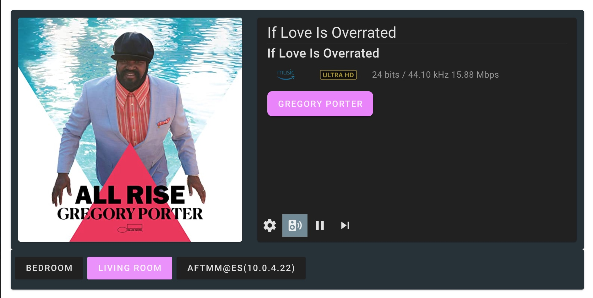
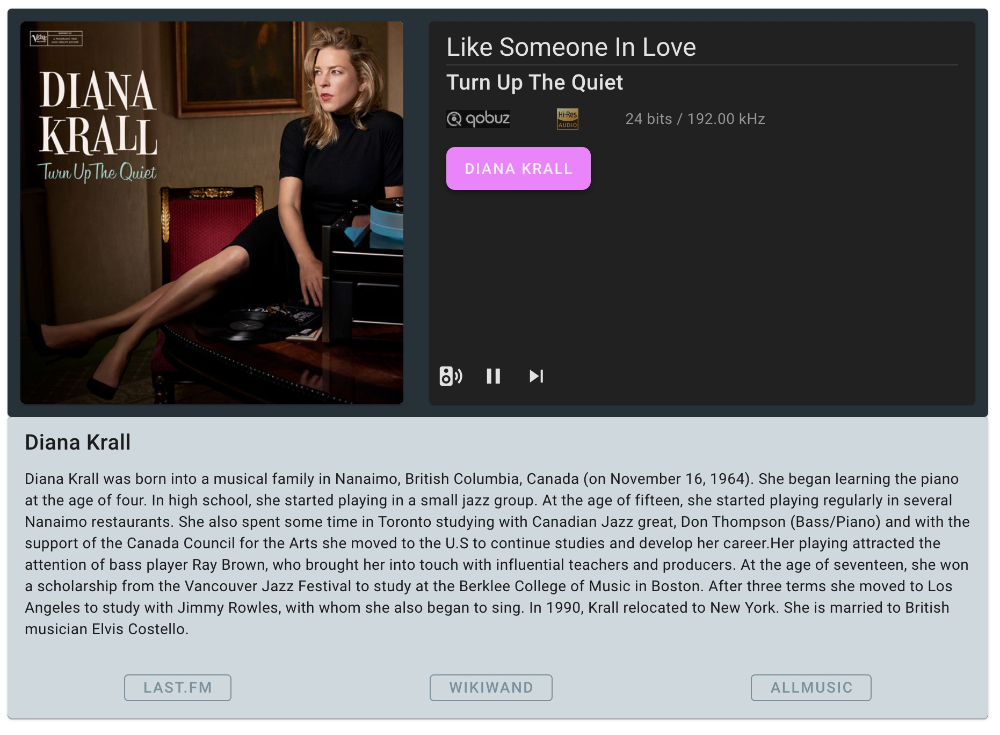
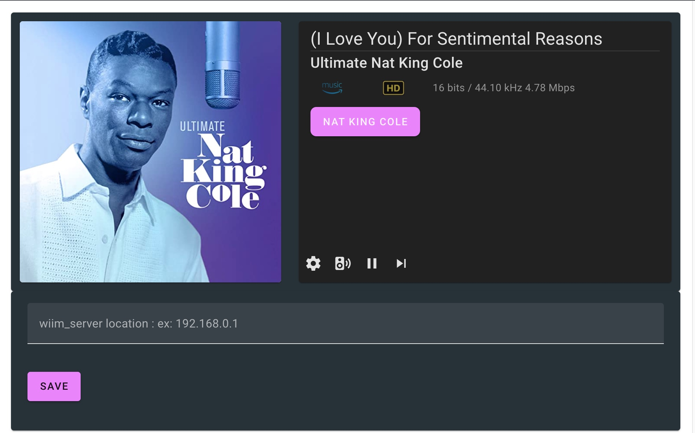
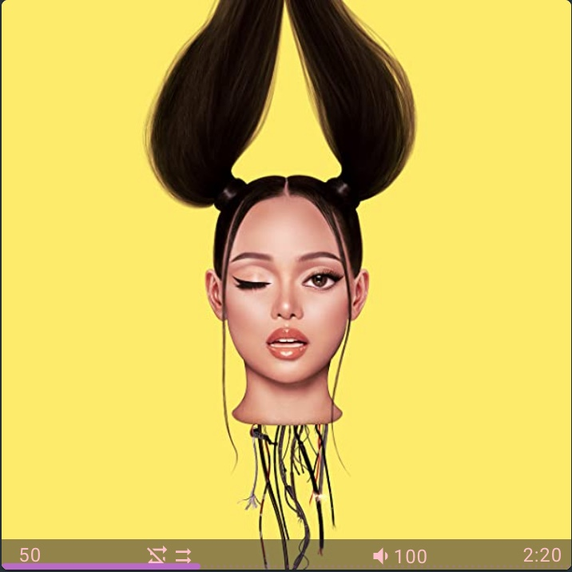

# wiim-mini-ui

A modern Web Control Point for UPnP/DLNA Media Renderers with rich metadata display and real-time playback control.

## Overview

This project provides a beautiful web interface to control UPnP Media Renderers on your local network. Originally built for WiiM Mini devices, it works with any UPnP-compliant renderer (Sonos, Chromecast, etc.).

**Supported Services**: Local DLNA servers, Spotify, Qobuz, iHeartRadio, TuneIn, Deezer, and Amazon Music.

## � Prerequisites

### Required
- **Node.js**: Version 18+ ([Download](https://nodejs.org/))
  - Recommended: Node.js 20 or 22 LTS
  - Check version: `node --version`
- **npm**: Version 8+ (included with Node.js)

### Optional
- **Docker Desktop**: For frontend container builds ([Download](https://www.docker.com/products/docker-desktop/))
  - Note: Backend cannot run in Docker on macOS/Windows due to multicast limitations

### Network Requirements
- UPnP/SSDP multicast support (UDP 239.255.255.250:1900)
- Development machine and media renderers on same LAN/WiFi
- Firewall must allow TCP 8080 (backend) and UDP 1900 (SSDP)

---

## 🚀 Quick Start

### 1. Clone and Install

```bash
git clone https://github.com/chrishuangcf/wiim-mini-ui.git
cd wiim-mini-ui
npm run init  # Installs both frontend and backend dependencies
```

### 2. Development Mode (Recommended)

Run backend and frontend in separate terminals:

**Terminal 1 - Backend:**
```bash
UPNP_DEBUG=1 npm run server:dev
# Runs on http://localhost:8080
```

**Terminal 2 - Frontend:**
```bash
npm run ui:dev
# Runs on http://localhost:5173 with hot-reload
```

Open browser to **http://localhost:5173**

### 3. Production Mode

```bash
npm run build              # Build frontend
cd wiim_server && node server.js  # Serve everything on :8080
```

Access at **http://localhost:8080**

> **Important**: Backend must run natively (not in Docker on macOS/Windows) because UPnP/SSDP multicast is blocked by Docker Desktop's network virtualization.

---

## 🛠️ Development Guide

### Project Structure
```
wiim-mini-ui/
├── web_client/              # Frontend (Vue.js + Vite)
│   ├── src/
│   │   ├── components/      # Vue components (DeviceList, AlbumArt, etc.)
│   │   ├── views/           # Page views
│   │   ├── store/           # State management (metadata)
│   │   └── router/          # Vue Router config
│   └── vite.config.mts      # Vite proxy configuration
│
├── wiim_server/             # Backend (Node.js + Express)
│   ├── server.js            # Main server with SSDP discovery
│   └── public/              # Built frontend (after npm run build)
│
└── package.json             # Root npm scripts
```

### Environment Variables

**Backend** (`wiim_server/.env`):
```bash
PORT=8080              # Server port (default: 8080)
UPNP_DEBUG=1          # Enable UPnP/SSDP debug logging
SSDP_INTERFACES=en0   # Specific network interface (optional)
SSDP_EXPLICIT_BIND=true  # Explicit socket binding (optional)
```

**Frontend** (`web_client/.env.development`):
```bash
# Backend URL (auto-detected if not set)
VITE_BACKEND_URL=http://localhost:8080
```

### Verification Steps

```bash
# 1. Check backend health
curl http://localhost:8080/health

# 2. View discovered devices
curl http://localhost:8080/discovery-debug | python3 -m json.tool

# 3. Open browser to http://localhost:5173
# - Health indicator (top-right) should be green
# - Device buttons should appear if renderers found
```

### Development Workflow

- **Frontend Hot Reload**: Edit `.vue`/`.ts` files in `web_client/src/` - changes reflect instantly
- **Backend Restart**: Edit `server.js`, then Ctrl+C and restart
- **Auto-restart**: Use `nodemon server.js` for automatic backend restart

### Recommended VS Code Extensions
- **Volar**: Vue.js 3 support
- **ESLint**: Code linting
- **Prettier**: Code formatting

---

## ⚙️ Run Modes

| Mode | Frontend | Backend | When to Use |
|------|----------|---------|-------------|
| **Development** | Vite dev server (:5173) | Native Node.js (:8080) | Active development with hot-reload |
| **Production** | Static files via Node.js | Native Node.js (:8080) | Single server deployment (Raspberry Pi, etc.) |
| **Docker Frontend** | Nginx container (:3000) | Native Node.js (:8080) | Test production build locally |

## 🩺 Health Monitoring

Backend exposes `/health` endpoint; UI polls every 10 seconds.
```json
{"status":"ok","services":{"upnp":{"status":"ok","deviceCount":2}}}
```

**Status Indicators:**
- 🟢 Green: Backend connected, devices found
- 🟡 Yellow: Backend connected, no devices yet
- 🔴 Red: Backend unreachable

## 🛰️ UPnP/SSDP Network Requirements

UPnP discovery uses multicast (239.255.255.250:1900 UDP). Docker Desktop on macOS/Windows blocks multicast traffic to containers, so **the backend must run natively** on the host to discover devices.

## 🔌 Backend URL Configuration

### Auto-Detection (Default)

Frontend connects using this priority:
1. `VITE_BACKEND_URL` environment variable
2. `window.location.origin` (same host/port)
3. Fallback to `http://<host>:8080`

### Configuration Scenarios

**Local Development (Default)**
```bash
npm run server:dev  # Terminal 1
npm run ui:dev      # Terminal 2
# No configuration needed
```

**Backend on Different Machine**
```bash
# Machine B - Backend
cd wiim_server && node server.js

# Machine A - Frontend
VITE_BACKEND_URL=http://192.168.1.100:8080 npm run ui:dev
```

**Production Build with Custom Backend**
```bash
VITE_BACKEND_URL=http://10.0.4.27:8080 npm run build
```

**Network Interface Selection**
```bash
# If backend binds to wrong interface
SSDP_INTERFACES=en0 node wiim_server/server.js  # macOS WiFi
SSDP_INTERFACES=eth0 node wiim_server/server.js # Linux Ethernet
```

## 🔍 Debugging & Troubleshooting

### Enable Debug Logging

```bash
# Backend with comprehensive UPnP output
UPNP_DEBUG=1 node wiim_server/server.js
```

### Quick Diagnostics

```bash
# Check backend health
curl http://localhost:8080/health

# View discovered devices
curl http://localhost:8080/discovery-debug | python3 -m json.tool

# Monitor SSDP traffic (requires sudo)
sudo tcpdump -i any 'udp port 1900' -A
```

### Common Issues

| Issue | Solution |
|-------|----------|
| **Port already in use** | `lsof -ti:8080 \| xargs kill -9` |
| **No devices discovered** | 1. Check same network<br>2. Allow UDP 1900 in firewall<br>3. Restart renderer devices<br>4. Try `SSDP_INTERFACES=en0 node server.js` |
| **Backend unreachable** | 1. Verify backend running: `curl http://localhost:8080/health`<br>2. Check firewall allows TCP 8080<br>3. Set `VITE_BACKEND_URL` explicitly |
| **Hot reload not working** | Hard refresh browser (Cmd+Shift+R) or restart dev server |
| **Build fails** | `rm -rf node_modules && npm run init` |

### Debugging Tips

- Check both terminal outputs (backend :8080, frontend :5173)
- Use browser DevTools (F12) to inspect Network tab
- Verify devices and dev machine on same LAN
- Use `/discovery-debug` endpoint to see parsed device data


## 🏗️ Architecture

### Technology Stack

**Frontend**
- Vue.js 3 (Composition API) + TypeScript
- Vuetify 3 (Material Design)
- Vite (Build tool)
- Pinia (State management)
- Socket.io Client (Real-time updates)

**Backend**
- Node.js 20 + Express
- Socket.io Server
- Native dgram SSDP implementation
- upnp-device-client (Media control)
- xml2js, cheerio (Parsing)

**UPnP Implementation**
1. SSDP Discovery: M-SEARCH multicast on 239.255.255.250:1900
2. Device Control: AVTransport & RenderingControl services
3. Event Subscription: Real-time playback state updates

---

## 🎨 Features

### User Interface
- **Now Playing**: Large album art with real-time playback info
- **Transport Controls**: Play, pause, next, previous, volume, shuffle, repeat
- **Track Info**: Title, artist, album, audio quality, bitrate, progress bar
- **Device Selector**: Switch between multiple UPnP renderers
- **Artist Biography**: Integrated web search
- **Responsive Design**: Desktop and mobile support

### Supported Services

| Service | Logo | Quality Indicators | Status |
|---------|------|-------------------|--------|
| Spotify | ✅ | MP3 | Full support |
| Qobuz | ✅ | CD/Hi-Res | Full support |
| Amazon Music | ✅ | HD/UHD | Full support |
| Deezer | ✅ | Standard | Full support |
| iHeartRadio | ✅ | Streaming | Full support |
| TuneIn | ✅ | Radio | Full support |
| Local DLNA | ✅ | Bitrate-based | Full support |
| TIDAL | ❌ | - | Not tested |

**Audio Quality Indicators:**
- **UHD**: >96kHz (Amazon Music)
- **Hi-Res**: >48kHz
- **CD**: 44.1kHz/16-bit
- **MP3**: Compressed formats

---

## � Deployment

### Raspberry Pi Setup

**1. Install Node.js on Raspberry Pi:**
```bash
sudo apt-get update && sudo apt-get upgrade
sudo apt remove node nodejs  # Remove old versions
curl -fsSL https://deb.nodesource.com/setup_18.x | sudo -E bash -
sudo apt-get install -y nodejs
node -v  # Verify installation
```

**2. Deploy Application:**
```bash
# On your development machine
npm run build

# Copy to Raspberry Pi
scp -r web_client/dist pi@raspberrypi:/destination/public
scp wiim_server/server.js wiim_server/package.json pi@raspberrypi:/destination/

# On Raspberry Pi
cd /destination
npm install
hostname -I  # Note your IP address
node server.js
```

Access at `http://[RASPBERRY_PI_IP]:8080`

**3. Auto-Start with PM2 (Optional):**
```bash
sudo npm install -g pm2
pm2 start server.js
pm2 startup systemd  # Follow the instructions
pm2 save

# Check status
pm2 list
pm2 status
pm2 show server
```

### Manual Deployment

For other systems:
1. `npm run build`
2. Copy `web_client/dist` → `<destination>/public`
3. Copy `wiim_server/server.js` and `package.json` → `<destination>/`
4. Run `npm install` and `node server.js`

---

## 📱 Usage

### Selecting a Renderer
Click the **SPEAKER** icon to select a UPnP Media Renderer. You must select a device before controlling playback.



### Artist Biography
Click the artist name to view biography information.



### Server Configuration
Click the **SETUP** icon to change backend server IP address if needed.




## 📝 Change Log

### October 2025
- Fixed crash when switching renderers during playback
- Switched from node-ssdp to native dgram UDP for SSDP discovery
- Improved reliability on macOS/Windows

### August 2022
- Added track length, playback time, shuffle/repeat mode, volume display
  

### July 2022
- Configurable server IP address (setup icon)
- Hide controls until renderer selected
- Moved to WebSocket (Socket.io) for real-time updates
- Enhanced metadata: Spotify (MP3), Qobuz (CD/Hi-Res), Amazon (UHD/HD), DLNA

---

## 🗺️ Roadmap

- [ ] OpenHome protocol support (BubbleUPnP, Chromecast, Volumio)
- [ ] Enhanced local UPnP metadata (LOSSY/LOSSLESS indicators)
- [ ] Improved metadata parsing for limited sources

---

## 📄 License

See [LICENSE](LICENSE) file for details.
